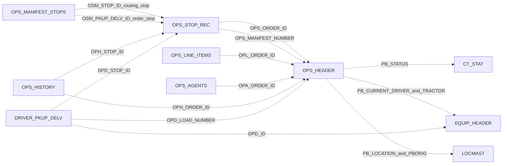

# Relationship diagrams

All arrows below are **inferred logical links**, not declared FKs. Arrow direction is child/reference → parent/target. See the relationship catalog for field mappings and confidence. The HTML includes an interactive neighborhood diagram for every table, so it is usually easier to navigate than a single 222-table drawing.

All the links in this focused diagram have explicit code evidence. Stop 0 is a sentinel for header-level history. Orders and manifests are roles of OPS_HEADER, not separate physical tables.

Area diagrams include **every table assigned to that area**, including unconnected nodes, plus outgoing relationships to other areas. Edge labels use the relationship ID in this snapshot and referencing columns from [RELATIONSHIPS.md](RELATIONSHIPS.md). The `.mmd` files can be opened in a Mermaid-capable editor.

- [Orders and manifests](diagrams/orders-and-manifests.mmd)
- [Accounts and carriers](diagrams/accounts-and-carriers.mmd)
- [Drivers and settlement](diagrams/drivers-and-settlement.mmd)
- [Equipment and fuel](diagrams/equipment-and-fuel.mmd)
- [Pricing and tariffs](diagrams/pricing-and-tariffs.mmd)
- [Maintenance and purchasing](diagrams/maintenance-and-purchasing.mmd)
- [Claims and receipts](diagrams/claims-and-receipts.mmd)
- [Containers and warehouse](diagrams/containers-and-warehouse.mmd)
- [Locations and routing](diagrams/locations-and-routing.mmd)
- [Integration and reference](diagrams/integration-and-reference.mmd)
- [Users and access](diagrams/users-and-access.mmd)
- [Codes and configuration](diagrams/codes-and-configuration.mmd)
